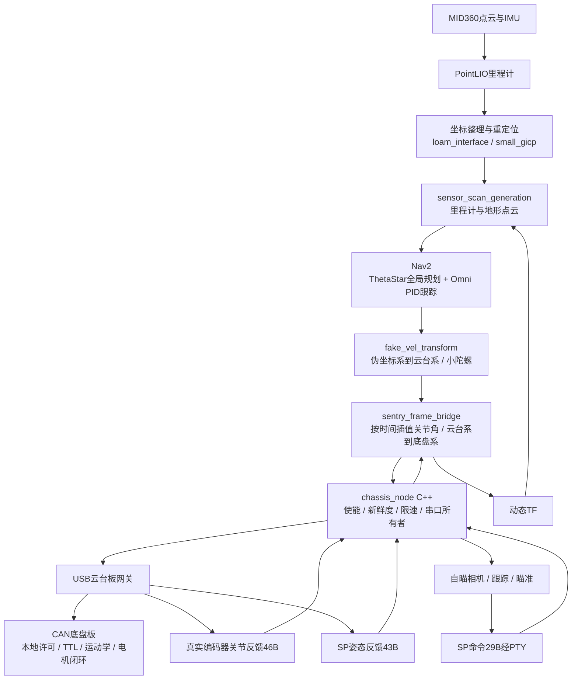

# RM哨兵实车算法架构与文件索引

日期：2026-11-09。适用对象：当前3V3哨兵、北极熊ROS2 Humble导航、SP自瞄、一根USB连接云台并由CAN连接底盘的双板结构。

本轮完成云台编码器状态→ROS关节/动态TF→云台系导航速度转换→底盘协议的源码接入与无硬件验证。物理零位、几何尺寸、本地许可和实车总线验收待完成。战术决策与射击许可没有在本轮新增实现。

## 总体数据流



上层决策通过Nav2目标、搜索/交战策略等接口工作；不能让决策、导航和自瞄同时直接改同一个电机目标。目标ID、敌方位置、队友血量/补位及射击授权属于战术接口，不能由USB转发或云台mode字段推导为已实现。

## 实车代码位置

工作区根目录：`C:/Users/zbh26/Desktop/code/robomaster`。实车与仿真共用`导航/pb2025_sentry_nav`算法源码，实车用`pb2025_nav_bringup/launch/rm_navigation_reality_launch.py`及`config/reality/nav2_params.yaml`。`pb_rm_simulation`是仿真工程。

| 层次 | 主要文件或目录 | 输入与输出 | 本轮状态 |
| --- | --- | --- | --- |
| 实车总入口 | rm_chassis_comm/launch/sentry_reality.launch.py | 启动通信/坐标桥；可选包含原实车导航入口 | 新增 |
| 原实车导航入口 | pb2025_sentry_nav/pb2025_nav_bringup/launch/rm_navigation_reality_launch.py | Livox、定位、Nav2、可选RViz | 沿用 |
| 实车算法参数 | pb2025_sentry_nav/pb2025_nav_bringup/config/reality/nav2_params.yaml | 点云/里程计/规划/控制及frame配置 | 沿用，含gimbal_yaw和3.14rad/s小陀螺 |
| 激光IMU里程计 | pb2025_sentry_nav/point_lio/src/laserMapping.cpp | 点云+IMU→位姿与配准点云 | 沿用 |
| 重定位 | pb2025_sentry_nav/small_gicp_relocalization/src/small_gicp_relocalization.cpp | 实时点云+先验地图→重定位变换 | 沿用 |
| 里程计坐标整理 | pb2025_sentry_nav/loam_interface/src/loam_interface.cpp | PointLIO坐标→导航坐标 | 沿用 |
| 点云和车体里程计 | pb2025_sentry_nav/sensor_scan_generation/src/sensor_scan_generation.cpp | 点云/里程计+TF→导航点云及odometry | 修改：缺TF跳过，去除单位变换回退 |
| 地形代价 | pb2025_sentry_nav/terrain_analysis、terrain_analysis_ext | 地面/高差点云→地形信息 | 沿用 |
| 代价地图扩展 | pb2025_sentry_nav/pb_nav2_plugins | 点云强度/高度信息→导航代价 | 沿用 |
| 全局规划 | Nav2的nav2_theta_star_planner插件 | 地图/目标→全局路径 | 实车参数已选择 |
| 全向路径跟踪 | pb2025_sentry_nav/pb_omni_pid_pursuit_controller/src | 路径/当前位姿→控制速度 | 沿用 |
| 云台参考速度 | pb2025_sentry_nav/fake_vel_transform/src/fake_vel_transform.cpp | 规划速度/odom→云台系速度+旋转 | 修改：额外发布一次性带时间戳输出 |
| 云台/底盘坐标桥 | rm_chassis_comm/src/sentry_frame_bridge.cpp | 关节状态+云台系TwistStamped→车体系TwistStamped/TF | 新增 |
| 转换数学 | rm_chassis_comm/include/rm_chassis_comm/frame_math.hpp | 历史插值、旋转、转轴偏置补偿 | 新增 |
| PC通信 | rm_chassis_comm/src/chassis_node.cpp | 规范车体系速度↔USB，SP代理、关节状态与诊断 | 修改 |
| MCU时钟映射 | rm_chassis_comm/include/rm_chassis_comm/gimbal_clock.hpp | 四时间戳→PC采样时刻估计 | 新增 |
| 云台关节协议 | rm_chassis_comm/include/rm_chassis_comm/gimbal_protocol.h、src/gimbal_protocol.c | 固定46B关节编码/解码 | 新增 |
| 已有自瞄程序 | 自瞄/sp_vision_25-自行修改-v0.1/src/sentry.cpp、io/gimbal/gimbal.cpp | 图像/SP姿态→瞄准目标，串口改接PTY | 本轮未改自瞄算法 |
| 云台固件 | rm_chassis_integration/firmware_gimbal_tracking | 原SP控制+真实关节采样+USB/CAN网关 | 修改副本 |
| 底盘固件 | rm_chassis_integration/firmware_chassis/application/chassis/chassis.c | 车体系SI速度→轮电机RPM | 沿用上一轮已接入副本 |

如本机改用另一份自瞄工程，应单独确认它的SP29/43格式及四元数参考系。此表给出当前工作区实际文件，不表示以上全部节点已在本轮一起运行。

## 速度链与坐标约定

串口协议只接受车体系：x前、y左、wz逆时针；线速度m/s、角速度rad/s。Nav2当前配置使用gimbal_yaw_fake，fake_vel_transform将其转换到gimbal_yaw，并叠加一次小陀螺。

```text
cmd_vel_nav2_result (Twist，原节点内部接口)
  → fake_vel_transform
cmd_vel_gimbal_stamped (TwistStamped，frame=gimbal_yaw)
  → sentry_frame_bridge
cmd_vel_body (TwistStamped，frame=base_footprint)
  → chassis_node
34B route2命令 → 云台USB → CAN → 底盘导航运动学
```

所有话题默认置于`/red_standard_robot1`。旧`cmd_vel`仅保留兼容；新的实车通信入口不直接订阅它。旧括号命名传输入口默认接`/chassis/manual_body_cmd_vel`，用于已确认车体系的独立测试。

令yaw关节原点在底盘中的位置为p，关节相对底盘角度为θ，则：

```text
v_body = Rz(θ) × v_gimbal + p × [0,0,wz]
wz_body = wz_gimbal
```

偏置项用于两套速度参考原点不重合的情况。若p为0，云台向左转90°时，云台系vx=1对应车体系vy=1。坐标桥不再增加旋转速度。

## 关节采样与时间

云台反馈来自真实电机ECD和速度，按固定机械零位与正方向转换。`GimbalGetJointSnapshot()`读取两轴反馈，采用较旧轴的采样时刻，检查反馈年龄与轴间偏差；仅两轴采样都推进时产生新的关节包。

`0x22`关节反馈回显云台本地收到的PC命令seq/session及接收时刻。PC先核对最近完整发送记录，再用PC发送/接收、MCU接收/发送四时间戳估算采样时间。估计会受到USB非对称延迟、MCU毫秒计时量化和调度影响；诊断中的不确定度为网络RTT的一半分量，不含全部物理误差，不代表硬件同步。

fake_vel_transform新增输出保留其实际使用的odom时刻与gimbal_yaw帧名。一份输入速度最多产生一份带时间戳输出，后续odom或路径到达不会给旧命令换新时间。零指令会清除先前非零缓存，同步回调一次性消费缓冲；伪坐标TF也保留原角度时刻，角度过期则停止发布。坐标桥保存最多64份关节样本，按命令时间插值；跨π按短弧处理，默认不外推。命令晚于最新样本时，只缓存最新一份等待后续样本，超时清除。

## TF所有权

| TF边 | 发布者 |
| --- | --- |
| map→odom | 原重定位/SLAM配置选择的节点 |
| odom→base_footprint | sensor_scan_generation，依赖真实里程计与静态外参 |
| base_footprint→gimbal_yaw | 新坐标桥，真实yaw与确认后的转轴位置 |
| gimbal_yaw→gimbal_pitch | 新坐标桥，真实pitch与确认后的转轴位置 |
| gimbal_yaw→gimbal_yaw_fake | 原fake_vel_transform |
| base_footprint→front_mid360、云台→相机等固定关系 | 已测量机器人描述，或新启动配置static_transforms |

同一条TF边只保留一个发布者。使用原robot_state_publisher发布动态关节时，将新配置的publish_tf设false，并把真实gimbal_joint_state接给该robot_state_publisher；坐标桥的几何配置仍须与URDF一致。

实车总入口显式关闭原导航的use_robot_state_pub，避免它用静态关节占用动态边。因此，必须另行提供真实雷达/相机固定外参。默认static_transforms为空，不会凭空生成雷达外参。缺少TF时现在丢弃导航样本，不能依靠单位变换继续工作。

## 配置和控制权

- `config/sentry_real.yaml`：PC帧名、转轴位置、动态TF发布权及可选固定外参。geometry_confirmed默认false。
- `firmware_gimbal_tracking/application/gimbal/nav_joint_config.h`：固定ECD零位、正方向、关节标定确认。确认默认0。
- `firmware_chassis/application/nav_config.h`：底盘导航许可与轮运动学标定。两项默认0；弱本地许可仍禁止导航。

PC启用前要求底盘READY及真实STOP确认、有效且推进的云台采样、坐标桥frame_ready。输入速度必须是指定车体系TwistStamped；原始时间戳的年龄参与TTL计算。云台无效、反馈断流、坐标状态中断、ROS时间跳变或重连会停止并撤销使能，恢复需再次显式使能和新指令。驱动拒绝时间戳早于该次使能的排队命令，并拒绝倒序命令覆盖新STOP；现场应等待使能后的新里程计及控制周期。MCU本地许可/急停与独立TTL继续生效。

云台原控制仍保留上传版的启动相对机械包络（yaw约±120°、pitch约±20°）。导航默认π rad/s旋转没有在本轮改掉；持续自旋时维持目标瞄准是否可行，还取决于滑环、线束、实际行程和后续限位协调策略。本轮接通坐标反馈，不等于已完成无限旋转云台或交战旋转调度。

底盘副本尚未接通人工驾驶通道。人工接管信号当前只禁止导航；不能把它理解为遥控驾驶已经完成。

## 构建与检查

以下为本机WSL命令，已安装依赖来自现有Humble环境；原导航其余包应使用本队已核对的工作区版本。

```bash
source /opt/ros/humble/setup.bash
nav='/mnt/c/Users/zbh26/Desktop/code/robomaster/导航'
build="$HOME/.cache/rm_sentry_gimbal_check"
export CMAKE_BUILD_PARALLEL_LEVEL=2
colcon --log-base "$build/log" build --executor sequential \
  --base-paths "$nav/rm_chassis_comm" "$nav/pb2025_sentry_nav/fake_vel_transform" \
               "$nav/pb2025_sentry_nav/sensor_scan_generation" \
  --build-base "$build/build" --install-base "$build/install" \
  --cmake-args -DBUILD_TESTING=OFF -DCMAKE_BUILD_TYPE=Release
source "$build/install/local_setup.bash"
```

先加载原导航依赖工作区，再加载上述最新overlay，避免仍运行旧fake_vel_transform。测试和检查记录见`VALIDATION.md`；源码测试入口在`test/`。

只预览接入节点，不连接硬件、不启动雷达：

```bash
ros2 launch rm_chassis_comm sentry_reality.launch.py
```

在电控完成零位/许可、机械外参核定及无运动链路验收后，使用独立实测配置启动。下列map和PCD为占位符，需替换成实际文件：

```bash
ros2 launch rm_chassis_comm sentry_reality.launch.py \
  connect:=true serial_port:=/dev/实际USB设备 \
  frame_config:=/绝对路径/实测sentry_real.yaml \
  start_navigation:=true map:=/绝对路径/场地.yaml \
  prior_pcd_file:=/绝对路径/先验点云.pcd
```

该命令不会自动使能底盘。检查`/red_standard_robot1/gimbal_joint_state`、`gimbal_state_valid`、`frame_ready`和`diagnostics`，核对两条动态TF，再由现场人员在受控条件下调用set_enabled。自瞄连接`sp_proxy`发布的PTY，不能抢占物理USB。

## 验证边界与验收顺序

本轮通过源码构建与虚拟硬件测试，不替代真车标定。先检查关节角方向/零位与TF，再架空验证+vx/+vy/+wz，随后低速验证底盘旋转时的指定方向移动。实体急停、反馈断开、CAN拥堵、USB重连及MCU任务停摆均需实际确认。

当前WSL此前的跨进程DDS障碍需要单独核对；同进程ROS/PTY回归不能证明跨进程或实车总线已经通过。此增量包包含通信、两份固件副本及被改动的导航组件，不包含整个导航依赖和先验地图。
