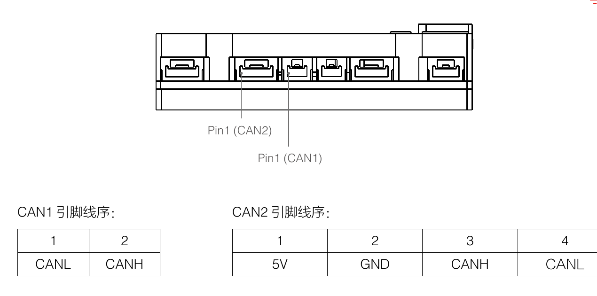

# 云台固件与 CAN 接线说明

日期：2026-11-11。

## 云台板烧录文件

工程目录：`/home/wangjiaming/桌面/c_board_nav_gateway_20261111`。

- 推荐用于 EmberProbe：`artifacts/gimbal_nav_converter.elf`。
- 支持 HEX 的烧录工具可选：`artifacts/gimbal_nav_converter.hex`。
- 两个文件对应同一份程序，选一个烧录即可，目标是云台 C 板。
- 完整源代码：`gimbal_firmware/`。

这是小电脑 USB → 云台 CAN1 ↔ 底盘 CAN2 的版本，两端 CAN 速率均为 1 Mbps。已重新编译并校验文件，但这份 CAN1 版尚未重新烧入云台板。默认关闭电机运动输出，用于先完成通信测试。完整导航仍需轴向、安装位置和关节零位等确认。

ELF SHA-256：`abffb6a7dd2e1d47ec5e8eab8cbd39c43f154514d47a91fa9a661d437a4b8bed`。

## CAN_H 与 CAN_L

CAN_H 与 CAN_L 是同一条 CAN 总线的差分信号对，收发器通过两根线之间的电压差识别数据。H/L 不是电源正负极，也不是分别的发送线/接收线。两根线共同承担双向通信，接线应 H 接 H、L 接 L。

## 插座左右及接线

以下方向以官方手册印刷第 12 页的侧视图为准：正对板上 CAN 插座开口，电路板在下、插座卡扣在上。从上往下看板面或从线束背面看时，不可直接套用这个左右关系。

| 接口 | 从左到右 |
|---|---|
| CAN1，两针 | 1：CAN_L；2：CAN_H |
| CAN2，四针 | 1：5V；2：GND；3：CAN_H；4：CAN_L |

因此，按上图朝向，CAN1 的 CAN_H 在右侧；CAN2 的 CAN_H 在左起第三针、右起第二针。

| 云台 C 板 | 底盘 C 板 |
|---|---|
| CAN1 第 2 针，CAN_H | CAN2 第 3 针，CAN_H |
| CAN1 第 1 针，CAN_L | CAN2 第 4 针，CAN_L |
| 板上 GND 或已确认的公共供电地 | CAN2 第 2 针，GND |

CAN1 两针接口没有 GND，需通过已确认的公共供电地或另接 GND 建立两板参考地。两块板按原供电方案分别供电；本次 CAN 转接不连接 CAN2 第 1 针的 5V，也不能把它误接到 H/L。

官方原装两针 CAN 线规定黑线为 L、红线为 H；原装四针 CAN 线的红线是 5V。改装线或第三方线必须核对针位，不凭颜色判断。

线束应在断电后接好。上述位置是板上插座的视角，线束插头接线面可能呈镜像。

## 依据与尚待确认

- 来源：`/home/wangjiaming/下载/RoboMaster  开发板 C 型用户手册 (1).pdf`，印刷第 4 页线材定义、第 11～12 页 CAN 插座和针序。
- 已确认：当前 ELF/HEX 文件存在，ELF 哈希与 CAN1 版构建记录一致。
- 未确认：用户当前线束的实际针序、两板公共地连接、终端电阻、最新版本是否已由用户自行烧录，以及新拓扑的实物双向通信。这些不能仅凭电源灯亮判断。
