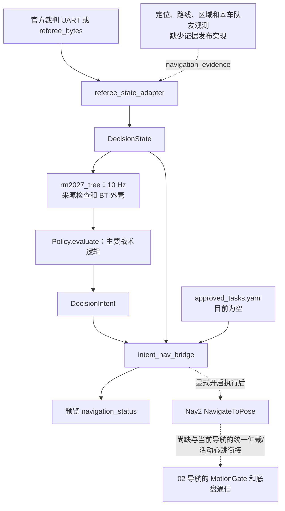

**06_决策：规则、逻辑架构与本机运行审查**

审查日期：2026-11-21，Asia/Shanghai。审查对象：`/home/wangjiaming/文档/GitHub/RM_11_13/06_决策` 的原始 33 个文件。

结论：这台电脑能够编译并运行该决策包；现有代码适合进行状态接入、策略回放和导航目标预览，尚不能直接完成实车比赛闭环。原始系统缺少 BehaviorTree.CPP 4，本次将官方 ROS 软件包解包到临时目录后，完整编译、CTest 和 ROS 数据流检查均通过。系统依赖没有永久安装。

本次新增审查文档、复现脚本和证据，没有修改原有决策逻辑、地图配置或板卡固件。测试使用本机回环 DDS、独立 ROS_DOMAIN_ID=173，未打开物理 UART，未启动真实导航、底盘或发射机构。

1. **审查覆盖范围与资料依据**

原始文件包括：5 份 PDF、5 份 Python 字节码，以及 23 份源码、消息、配置、行为树、测试和说明文件。比赛规则正文逐节阅读；其余手册重点核对本包适用的串口、通信限制、哨兵、运行平台与参赛验收条款。关键表格和规则页另外渲染核对。没有把所有手册的 357 页都视为已逐页进行图像审查。

| 文件组 | 实际内容与审查结果 |
|---|---|
| `src/decision_node.cpp` | 一个 ROS C++ 节点，负责来源时间校验、消息转换、BT 执行和意图发布 |
| `include/rm2027_decision/` | `policy.hpp` 为主要战术逻辑；`freshness.hpp` 为 ROS/steady 双时钟的新鲜度判断 |
| `scripts/` | 官方裁判帧接收器、裁判/导航状态适配器、Nav2 意图桥接器；源码语法及安装后的运行通过 |
| `msg/` | 5 种软件消息：本车/队友状态、候选任务、决策意图、导航证据；不是电控串口协议 |
| `launch/` | 单独意图检查入口和三个节点的整合入口；默认均禁用实际执行 |
| `config/` | 策略阈值和空的批准点位表；空表会阻止开启导航执行 |
| `trees/` | 一个仅包含 ReadState、SelectIntent、PublishIntent 的 Sequence |
| `test/` | 两个独立 C++ 断言程序；Release 下保留 assert，本次均通过 |
| 两份 Markdown | 需求描述与核心策略基本一致；README 版本、适配进度和构建路径已落后于实际代码 |
| `LICENSE` | Apache-2.0 许可证文本；README 引用的上游来源清单不在当前工作区 |
| 5 个 `.pyc` | 与本机 Python 3.10 的 magic 不一致，其中整合 launch 的缓存还落后于源码；本次使用 `.py` 源码正常运行，它们不是部署入口 |

资料文件：

- [2027 联盟赛比赛规则 V1.0.0](</home/wangjiaming/文档/GitHub/RM_11_13/06_决策/race rule text/RoboMaster 2027 机甲大师高校联盟赛比赛规则手册 V1.0.0（20261015）.pdf>)：本包赛项、机制与行为约束的主要依据。
- [2027 通信协议 V1.0.0](</home/wangjiaming/文档/GitHub/RM_11_13/06_决策/race rule text/RoboMaster 2027 机甲大师高校系列赛通信协议 V1.0.0（20261029）.pdf>)：当前接收器的字段、长度及 CRC 依据。
- [2026 通信协议 V2.0.0](</home/wangjiaming/文档/GitHub/RM_11_13/06_决策/race rule text/RoboMaster 2026 机甲大师高校系列赛通信协议 V2.0.0（20260626）.pdf>)：仅用于差异对照，不能直接替换 2027 解码定义。
- [2027 机器人制作规范 V1.0.0](</home/wangjiaming/文档/GitHub/RM_11_13/06_决策/race rule text/RoboMaster 2027 机甲大师高校系列赛机器人制作规范手册V1.0.0（20261015） (1).pdf>)：核对通信设备、开源操作系统、哨兵与定位模块的适用范围。
- [2027 联盟赛参赛手册 V1.0.0](</home/wangjiaming/文档/GitHub/RM_11_13/06_决策/race rule text/RoboMaster 2027 机甲大师高校联盟赛参赛手册V1.0.0（20261015）.pdf>)：报名、评审、奖项和参赛安全内容，不提供本包运行所需的软件接口。

结论针对目录内这些版本，没有在线核验后续增补或答疑。

2. **规则与当前实现的对应关系**

下表页码为手册印刷页码。

| 规则依据 | 规则要点 | 代码现状与判断 |
|---|---|---|
| 比赛规则 3.1.3，p.20–21 | RMUL 3V3 哨兵全自动，遥控器用于调试，不允许多机通信 | `profile=rmul_3v3` 正确；本包没有发送机器人间通信。队友观察来源仍未实现，不能为接入方便增加未经允许的链路。同一辆车内部的 USB/CAN 双板通信可用于车内数据传递 |
| 比赛规则 3.1.3，p.20–21 | 哨兵 400 HP、100 W、热量上限 260、冷却 30/s、弹速上限 25 m/s；初始允许发弹量 750，局内不能增加 | 策略按有效最大血量计算恢复阈值，未请求购弹；功率、弹速属于执行层职责。弹药/热量输入和实际射击执行尚未完成 |
| 比赛规则 3.3.2，p.34–35 | 自动读条复活，首次读条 5、每次增加 5；复活后 20% HP，30 秒无敌并处于虚弱；己方补给区 RFID 解除虚弱与无敌 | 死亡分支不请求免费/付费复活，方向正确；已观察到的复活会标虚弱。无敌时长不能代替虚弱解除证据。生命状态重同步存在下述问题 |
| 比赛规则 3.3.2、3.3.4，p.35–37 | 正常补给按 25% 最大 HP/s；控制度落后达到阈值会改变恢复/复活收益 | 30% 进入、80% 退出是工程策略，并非官方要求；当前未按控制度差和剩余时间调整收益 |
| 比赛规则 3.3.4，p.36–37 | 控制区双方进度独立，最多 5；双方激活时暂停；离开后会失去控制 | 有持守、交接、岗位漏项保留等策略，思路符合持续维护需求；没有实现完整占领进度/双方激活状态模型，真实维护证据没有生产端 |
| 比赛规则 3.3.4、3.3.7，p.37–38 | 双方初始控制度 600；控制一区使对方每秒减 1，己方每次战亡减 10；控制度优先决定胜负 | `DecisionState` 没有双方控制度与剩余比赛时间，解码时也丢弃这些已有协议字段；不是完整的胜负目标决策 |
| 比赛规则 R42、R45，p.58–59 | 不得主动冲撞对方，不得进入对方补给禁区 | 本包只信任外部的“路线已验证”标志；没有场地禁区几何、全车轮廓检查或沿途禁行过滤。后续地图/执行层必须落实 |
| 比赛规则 3.2.3、3.3.5，p.25–27、37 | 场地有高地、隧道及对应收益 | 当前禁止走高地/隧道是本队车辆能力约束。过滤目标及路径标志合理，但路线验证程序未接入；算法不能补足车辆的通行能力 |
| 通信协议表 1-6，p.7–8 | game_type=4 为联盟赛 3V3，game_progress=4 为比赛中 | 位提取及门控正确；没有把模拟器的阶段枚举套进来 |
| 通信协议表 1-9，p.9–11 | 中央区控制状态位于第二个 uint32 的 bit26–27 | 当前偏移和己方/对方映射正确；bit24–25 的双方激活状态没有保留 |
| 制作规范 2.1.9 S60、哨兵模块表，p.20、31 | 机载平台使用开源操作系统；RMUL 不适用官方定位模块 | 本机 Ubuntu 满足操作系统类型要求；0x020B 有协议定义不等于本赛项必然有可用队友坐标，不能假定能收到真值位置 |

当前接收器允许的帧长度与 2027 定义一致：0x0001=11、0x0003=24、0x0101=8、0x0201=17、0x0209=6。2026 对应的 HP/事件/RFID 长度为 20/4/5，不能混用。CRC8、CRC16 的位运算实现另与官方附录的两张 256 项查表和 5 组输入核对一致。

3. **实际逻辑架构**



分层有明确边界，策略可在没有 ROS 的情况下测试；独立来源时间、时钟回退清理、恢复滞回、未知风险拒绝、候选上限和默认禁用都值得保留。

行为树 XML 只串接读取、选择、发布。真正的优先级写在 [policy.hpp](/home/wangjiaming/文档/GitHub/RM_11_13/06_决策/include/rm2027_decision/policy.hpp:117) 中：门控 → 死亡/生命/定位检查 → 自身恢复 → 持守 → 补位 → 队友撤退掩护 → 占领 → 显式巡逻 → 等待。修改 XML 不会改变这些战术优先级。作为初始框架可用；战术增长后可将条件和行为分拆成独立节点。

4. **需要优先处理的问题**

| 优先级 | 问题及触发条件 | 影响与证据 |
|---|---|---|
| P1，实车阻塞 | 没有 `NavigationEvidence` 发布端，批准任务为空 | 现有 02 导航输出没有转换为此接口；没有定位/路线/区域证据时停在 LocalizationLost/WaitPlan，开启真实桥接还会因点位为空退出。见 [证据订阅](/home/wangjiaming/文档/GitHub/RM_11_13/06_决策/scripts/referee_state_adapter.py:58) 和 [点位表](/home/wangjiaming/文档/GitHub/RM_11_13/06_决策/config/approved_tasks.yaml:5) |
| P1，已复现 | 比赛中途启动，或本车 HP 更新间隔达到 1 秒，生命状态变为未知 | 后续持续收到正 HP 及己方补给卡仍不能恢复 known；若之后没有新的战亡/复活证据或下一局倒计时，会持续 WaitState。原因是补给卡处理又要求先 known。见 [生命状态机](/home/wangjiaming/文档/GitHub/RM_11_13/06_决策/scripts/referee_rx.py:87)，复现数据见 `unknown_life_does_not_recover_on_supply` |
| P1，执行衔接缺失 | 当前桥接默认 Action 地址与 02 的 live 导航入口不同，且没有适配活动心跳和目标仲裁 | 06 默认 `/red_standard_robot1/navigate_to_pose`，02 的 live 入口为根命名空间 `/navigate_to_pose`。即使改对地址，[MotionGate](/home/wangjiaming/文档/GitHub/RM_11_13/02_导航（含通信）/src/rm_live_nav/rm_live_nav/motion_gate.py:42) 仍要求 `live/exploration_active` 心跳，而 06 不发布。决策与探索器同时开启还会竞争目标 |
| P2，已复现 | Nav2 拒绝/中止目标后，相同目标 ID 不再发送；成功后产生同 ID 的新需求也被抑制 | `last_attempt` 仅在 canceled 时清除。一次失败可能永久停止该任务，守点成功后被推离也可能无法返回。见 [同目标抑制](/home/wangjiaming/文档/GitHub/RM_11_13/06_决策/scripts/intent_nav_bridge.py:253) 和 [结果清理](/home/wangjiaming/文档/GitHub/RM_11_13/06_决策/scripts/intent_nav_bridge.py:344) |
| P2，已复现 | 即使本车观察已确认队友生命状态与最大血量，0 HP 仍不被标为有效健康观察 | `0 < ally.hp` 排除了零，Policy 实际收到 Unknown，不能触发预期的 Dead 分支或相应掩护分类。见 [队友适配](/home/wangjiaming/文档/GitHub/RM_11_13/06_决策/scripts/referee_state_adapter.py:136)。官方 HP=0 也可能是未上场/罚下，修复不能简单把所有零血都当战亡 |
| P2，功能未完成 | 当前适配器不解析 0x0202 热量、0x0208 允许发弹量，也不填射击许可 | 接真实裁判流时 `ammunition_valid` 和 `shooter_enabled` 仍为 false；射击意图与执行没有形成闭环。见 [支持命令列表](/home/wangjiaming/文档/GitHub/RM_11_13/06_决策/scripts/referee_rx.py:18) |
| P2，射击接入前应完善 | `fire_allowed` 只比较当前 heat < limit，没有给下一发预留热量 | 用完整正常输入、heat=255、limit=260 测试仍给 true；17mm 下一发增加 10，不能把此位单独作为开火授权。当前真实适配器默认禁射，没有验证或触发实物射击。见 [热量判断](/home/wangjiaming/文档/GitHub/RM_11_13/06_决策/include/rm2027_decision/policy.hpp:216) |
| P2，规则落地缺失 | 控制度、剩余时间、双方激活和占领进度未进入完整状态/策略；敌方补给禁区没有几何实现 | 核心规则仍停留在接口约定与文档。不能仅凭“平地、reachable、route_verified=true”证明能参赛并守规 |
| P2，恢复性与退出路径 | UART 发生 OSError 后不重新打开；桥接退出只异步请求取消，随即销毁节点 | UART 重插需重启，且重启涉及上述生命重同步问题。异步取消不等于已确认 Nav2 停止；SIGKILL/进程崩溃的实车停止保障未验证。见 [串口断线分支](/home/wangjiaming/文档/GitHub/RM_11_13/06_决策/scripts/referee_state_adapter.py:185) 和 [桥接退出](/home/wangjiaming/文档/GitHub/RM_11_13/06_决策/scripts/intent_nav_bridge.py:365) |
| P3，配置一致性 | 整合 launch 给 tree/bridge 加载策略 YAML，但 Adapter 没有加载同一份 map_frame 配置 | 默认 map 时正常；修改地图帧时可能出现适配器仍输出 map、下游拒绝输入的情况。见 [整合入口](/home/wangjiaming/文档/GitHub/RM_11_13/06_决策/launch/rm_11_13.launch.py:25) |
| P3，文档过期 | README 标 0.2.0，package.xml 为 0.3.0，仍称无真实适配/无 Action client，构建路径为旧 Windows/WSL 工程 | 按原文命令不能在当前目录直接运行；还引用了不存在的 `UPSTREAM_SOURCES.json`。应按当前三个节点与五种消息更新文档 |

对生命状态问题，应增加有明确来源的重同步流程，用可靠生命反馈或己方补给 RFID 等证据确认，不能直接强制 `life_state_valid=true`。对 Nav2 任务，建议使用任务代次、受限重试、退避和结果反馈，区分“同一次请求重复发送”和“同一位置的新任务”。这些是修复建议，本次未改逻辑。

5. **本机实际验证结果**

本机：Ubuntu 22.04.5 LTS，x86_64；Intel i7-1165G7，8 逻辑线程；约 31 GiB 可见内存；Python 3.10.12；ROS 2 Humble；GCC 11.4。此决策包本身没有 GPU 依赖。未做自瞄、建图、导航、决策同时运行的长期性能验收。

| 检查 | 结果 | 范围 |
|---|---|---|
| 原始环境完整 colcon build | 失败，缺 `behaviortree_cpp` | 系统只有 `behaviortree_cpp_v3`，不能满足 v4 头文件/库依赖 |
| 临时解包官方 BT4 4.11.0 后完整构建 | 通过，约 18 秒 | 未改工程源码，5 种接口和全部安装项生成成功，编译 stderr 为空 |
| 独立 C++17 编译、运行两项测试 | 通过 | `-O2 -DNDEBUG -Wall -Wextra -Wpedantic -Werror`；确认断言在 Release 下仍执行 |
| CTest | 2/2 通过 | `rm2027_policy`、`rm2027_freshness` |
| 5 份 Python 源码/launch 语法 | 通过 | 使用本机 Python 3.10，未使用旧 `.pyc` |
| 官方 CRC 表对照 | 通过 | 两张 256 项表、5 组输入，包含 512 字节边界输入 |
| 接收器检查 | 通过 | 逐字节分帧、噪声重同步、坏 CRC 拒绝、中央区位偏移、旧 HP 长度拒绝 |
| 单节点默认启动 | 通过 | 4 秒内收到 37 条意图，均为 Disabled |
| 单节点 enabled=true、无输入 | 通过 | 4 秒内收到 38 条意图，均为 WaitState |
| 三节点默认入口 | 通过 | 收到 38 条 Disabled、72 条状态，桥接报告 waiting:intent:Disabled |
| 三节点合成裁判/导航证据链路 | 通过 | 倒计时 → 比赛中 → Patrol → preview:review_patrol；停止输入后 WaitState；开火许可帧数为 0 |
| 异常分支复现 | 已确认问题 | 生命状态未知不能靠补给卡恢复、确认零血队友被滤掉、同目标结果后不重发、255/260 热量仍许可 |
| 真实裁判串口、真实 Nav2 到达/避障、实车运动、实物射击 | 未验证 | 本次没有运行这些操作，不能由上述软件测试推断通过 |

临时测试目标 `review_patrol` 是独立域内的合成数据，不是赛场测量点，未写入批准任务表。合成链路结果证明接口与程序可运行，不证明真实观测、地图、战术或车辆运动正确。

6. **与当前机器人接通前还缺什么**

- 确定真实裁判数据入口：本包直接读取的是官方 0xA5 帧，支持专用 UART 或 `referee_bytes`。不能把现有云台 USB 的运动 ACK/状态包直接喂给此解码器；需落实电控转发或电脑的专用裁判 UART。
- 增加导航证据生产节点：把实际定位/TF、规划结果、禁区过滤、车体尺寸与路线风险转换成 `NavigationEvidence`；时间戳保留原始证据时间。
- 标定比赛地图和批准任务：己方补给点、可达中央区、掩护/巡逻点、红蓝坐标转换、敌方补给禁区；不能从示意图臆造坐标。
- 增加队友本车观察适配：确认最大 HP、是否上场/罚下/战亡/虚弱与位置。没有可靠来源时保留 Unknown，不能自动给出“岗位空缺”。
- 统一决策与自主探索的执行仲裁、Action 命名空间和 MotionGate 活动心跳；补取消/超时/失败/到达反馈及决策进程故障时的停止约束。
- 若接入射击，增加弹药/热量解析、逐发预算、裁判/规则/硬件许可合取，以及与自瞄/云台执行层的接口。
- 当前 [雷达安装配置](/home/wangjiaming/文档/GitHub/RM_11_13/02_导航（含通信）/local/live_mounting.yaml:3) 仍是 configured=false、旋转角未确认；当前继续固定姿态建图，不具备直接开启实车比赛导航的外参条件。

推荐顺序为：先修生命重同步与 Nav2 任务生命周期，再完成裁判和导航证据输入；使用有规则标注的固定地图验证占点/撤退；接通统一执行仲裁后再开展实车验收。无需为让程序“跑起来”放宽故障、时间或路线有效性门控。

7. **本机后续构建与只读预览命令**

以下为安装缺失依赖后的持久构建方法。本次没有执行系统安装命令；临时 BT4 目录不作为正式部署位置。

```bash
sudo apt install ros-humble-behaviortree-cpp
source /opt/ros/humble/setup.bash
cd '/home/wangjiaming/文档/GitHub/RM_11_13'
colcon --log-base /home/wangjiaming/.cache/rm2027_decision_ws/log build \
  --base-paths '/home/wangjiaming/文档/GitHub/RM_11_13/06_决策' \
  --build-base /home/wangjiaming/.cache/rm2027_decision_ws/build \
  --install-base /home/wangjiaming/.cache/rm2027_decision_ws/install \
  --packages-select rm2027_decision \
  --cmake-args -DBUILD_TESTING=ON -DCMAKE_BUILD_TYPE=Release
ctest --test-dir /home/wangjiaming/.cache/rm2027_decision_ws/build/rm2027_decision --output-on-failure
source /home/wangjiaming/.cache/rm2027_decision_ws/install/local_setup.bash
ros2 launch rm2027_decision rm_11_13.launch.py enabled:=false execute_navigation:=false
```

另一个加载相同 ROS 和安装环境的终端可以查看：

```bash
ros2 topic echo /decision2027/intent
ros2 topic echo /decision2027/navigation_status
```

默认应输出 Disabled 和 waiting:intent:Disabled。仅将 enabled 改为 true、没有真实有效输入时，预期是 WaitState。这些命令不填物理串口、不启用导航执行。

8. **证据与复查入口**

- [原始文件 SHA256、机器与构建记录](/home/wangjiaming/文档/GitHub/RM_11_13/06_决策/review/20261121/inspection-manifest.json)
- [独立编译/语法结果](/home/wangjiaming/文档/GitHub/RM_11_13/06_决策/review/20261121/standalone-results.json)、[CTest 日志](/home/wangjiaming/文档/GitHub/RM_11_13/06_决策/review/20261121/ctest.log)
- [ROS 启动及合成数据流结果](/home/wangjiaming/文档/GitHub/RM_11_13/06_决策/review/20261121/runtime-results.json)、[复查脚本](/home/wangjiaming/文档/GitHub/RM_11_13/06_决策/review/20261121/runtime_smoke.py)
- [逻辑问题复现结果](/home/wangjiaming/文档/GitHub/RM_11_13/06_决策/review/20261121/audit-checks-results.json)、[复现脚本](/home/wangjiaming/文档/GitHub/RM_11_13/06_决策/review/20261121/audit_checks.py)
- [热量许可探针结果](/home/wangjiaming/文档/GitHub/RM_11_13/06_决策/review/20261121/heat-probe-result.json)、[官方 CRC 表校验结果](/home/wangjiaming/文档/GitHub/RM_11_13/06_决策/review/20261121/protocol-crc-validation.json)

完整构建 stdout/stderr、各次启动日志位于同一 review 目录；原始配置/源码的哈希保存在清单中。复查脚本用于隔离软件检查，不能作为实车启动脚本。
